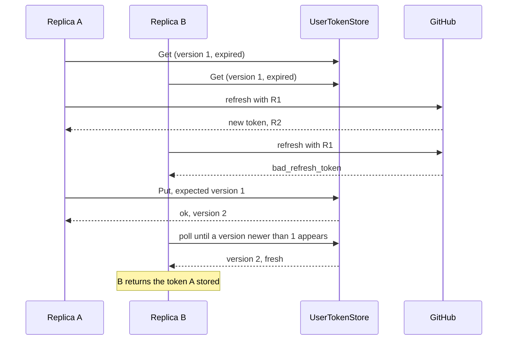

# Outbound credentials

Picture an app that mounts a person's private GitHub repo and reads it every few minutes, long after the person closed the tab. The app needs a GitHub credential that is still valid with nobody present. The rest of oneauth signs people in to the app. The `outbound` package covers the other direction: the app calling someone else's API, as itself or for one of its users.

Issue #467 tracks this work. The first consumer is goapplib's connections design (panyam/goapplib#153), which keeps the connection record and decides which mounts use which credential. oneauth supplies the credentials.

## The three sources

Each source is an `oauth2.TokenSource`. `oauth2.NewClient(ctx, src)` turns one into an `*http.Client`, and SDKs that take a client or a token source use it directly.

| Source | For | Lifetime | Where the secret lives |
|---|---|---|---|
| `GitHubAppInstallation` | The app acting as a GitHub App installation (server scope) | 1 hour, cached | The App's private key, loaded by the caller |
| `StoredUserToken` | The app acting for one person who connected their account | 8 hours, refreshed | Sealed in a `UserTokenStore` |
| `Static` | A personal access token or other fixed secret | No expiry | An env var or a mounted file, named by a `SecretRef` |

### GitHub App installation tokens

`GitHubAppInstallation{AppID, InstallationID, Key}` signs a JWT with the App's RSA key and posts it to `/app/installations/{id}/access_tokens`. GitHub answers with a token that lasts an hour. The source caches it and fetches a new one five minutes before it expires (`DefaultRefreshBefore`).

- The JWT has `iat` 60 seconds in the past, to absorb clock drift, and `exp` nine minutes ahead. GitHub refuses anything over ten minutes. `iss` is the App ID or the App's Client ID; GitHub accepts either.
- `NewGitHubAppInstallation` takes the key as PEM. GitHub's settings page downloads PKCS#1 (`RSA PRIVATE KEY`), and `utils.ParsePrivateKeyPEM` reads only PKCS#8, so `ParseRSAPrivateKeyPEM` reads both. Keys under 2048 bits are refused, as everywhere else in oneauth.
- Concurrent callers share one fetch. The cache holds a mutex across the exchange, so twenty goroutines starting at once make one request.
- The handed-out token's `Expiry` is five minutes before GitHub's. `oauth2.NewClient` wraps a source in a `ReuseTokenSource`, which keeps a token until ten seconds before `Expiry`. Without the shift, the margin would be lost whenever the source is used that way. GitHub's own expiry is in `tok.Extra("expires_at")`.
- `Repositories` and `Permissions` narrow a token below the installation's grant, using the fields GitHub's request body accepts. A mount over one repo can ask for `contents: read` on that repo only.
- `BaseURL` defaults to `https://api.github.com`. GitHub Enterprise Server uses `https://HOST/api/v3`, and tests point it at the fake.
- `Invalidate` drops the cache. Call it when an API answers 401 to a token that should still be live, for example after the installation was suspended and restored.

### Stored user tokens

A person connects their account through `oauth2.GithubOAuth2`. The provider hands `HandleUserFunc` an `oauth2.Token`, and the app saves it:

```go
tokens, _ := outbound.NewUserTokens("github", store, masterKeyHex, githubOAuthConfig)

// In HandleUserFunc, after the connect flow:
tokens.Save(ctx, userID, token)

// Later, from any replica:
client := oauth2.NewClient(ctx, tokens.TokenSource(userID))
```

Each `Token` call reads the store, opens the record, and returns the token when it has more than five minutes left. Otherwise it refreshes the token with its refresh token, writes the result back, and returns it.

Errors a caller acts on:

- `ErrUserTokenNotFound`: the person never connected, or disconnected.
- `ErrReconnect`: the token expired with no refresh token, or the provider refused the refresh token. The app sends the person through the connect flow again.
- `keys.ErrSealedOpen` (wrapped): the record doesn't open. The master key changed, or someone copied the ciphertext from another person's record.

`accounts.Channel.Credentials` could hold a token too, but it stores a plain map with no encryption, and `SaveChannel` doesn't check `Version`. Both matter here, so user tokens get their own store.

#### Refresh races

GitHub's refresh tokens are single-use. Refreshing hands back a new refresh token, and the old one stops working at once. Suppose two replicas find the same token expired and both refresh. GitHub accepts the first request and refuses the second with `bad_refresh_token`. If the replicas wrote blindly, the store could end up holding a refresh token GitHub has already retired, and the person would have to reconnect at the next expiry.

`UserTokenStore.PutUserToken` is a compare-and-swap on `Version`, and `StoredUserToken` uses it like this:



- The refresh that wins writes with the version it read. A write from a stale version fails with `ErrVersionConflict`, and the writer reads the stored token instead of overwriting it.
- A refresh that GitHub refuses doesn't mean the person has to reconnect yet. The winner may still be writing. The loser polls the store for up to `RaceWait` (two seconds by default) for a newer fresh version, and returns that. Only then does it answer `ErrReconnect`.
- Within one process, a mutex per subject serializes refreshes, so one replica never races itself.

`usertokentest.RunAll` checks a backend for this contract. One of its tests races sixteen writers from the same version and expects one success and fifteen conflicts.

#### Backends

| Backend | Compare-and-swap scope |
|---|---|
| `outbound.MemoryUserTokenStore` | One process. For tests and single-process tools. |
| `stores/fs.FSUserTokenStore` | One process. A mutex covers check and rename, but two processes sharing the directory can both pass the check. |
| `stores/gorm.UserTokenStore` | Every replica sharing the database. Each write is one statement: an insert with `ON CONFLICT DO NOTHING`, or an update `WHERE version = ?`. No row affected is a conflict. |
| `stores/gae.GAEUserTokenStore` | Every replica sharing the Datastore. Get, compare and Put run in one transaction, and a transaction that loses after Datastore's retries is a conflict too. |

Replicas that refresh tokens need the GORM or GAE store. The FS and GAE stores name each record by a SHA-256 of provider and subject, so two keys never share a record and no subject can steer a path.

#### Disconnecting

`Delete` drops the stored token and leaves it working at GitHub. `Revoke` revokes it first, through `UserTokens.Revoker`:

```go
tokens.Revoker = &outbound.GitHubRevoker{ClientID: id, ClientSecret: secret}
err := tokens.Revoke(ctx, userID)
```

- `GitHubRevoker` calls `DELETE /applications/{client_id}/token`, which revokes the access token and its refresh token. With `RevokeGrant` it calls `/grant` instead. That also removes the person's authorization of the app and every token it gave them, so their next connect shows the consent screen again.
- Only GitHub's 204 counts as revoked. GitHub answers 404 both for a token that's already revoked and for wrong client credentials, so a 404 is an error. A refused revoke keeps the record, so the app can retry.
- A second `Revoke` finds no record and returns nil without calling GitHub.
- A record that won't open is kept and its error returned, since the token may still be live. `Delete` removes it anyway.
- `Revoke` holds the per-subject lock, so a refresh in the same process can't write a token back after it.

### Static secrets

`Static` wraps a personal access token or another fixed bearer secret. It reads the secret from a `SecretRef` on every call, so rotating a mounted file needs no restart.

A `SecretRef` names where a secret lives and never holds it:

- `env:NAME` reads the environment variable `NAME`.
- `file:/abs/path` reads the file. The path must be absolute.

`ParseSecretRef` refuses anything else, including a bare value. A token pasted into config fails at startup, and the error doesn't repeat it. `NewStatic` also resolves the reference once, so a missing secret fails at startup rather than on the first API call. Cloud secret managers are a later addition; their reference will be another prefix.

## Encryption at rest

`keys.Sealer` holds the AES-256-GCM code that used to be private to `EncryptedKeyStorage`. Both key stores and `UserTokens` now use it.

- The output format is unchanged: `oaenc1:`, a random 12-byte nonce, then ciphertext and tag. Records written before this change still open.
- The AES key comes from the 64-hex-character master key through HKDF-SHA256 with a purpose label. The key stores use `oneauth-keystore-encryption-v1` (`keys.KeyStorePurpose`), as before. User tokens use `oneauth-outbound-user-token-v1`. One master key can serve both without the two sharing an AES key.
- Every seal carries associated data naming its record. For user tokens that is `oneauth-user-token`, the provider and the subject. A ciphertext copied into another person's record fails to open.

## Asking for more scopes later

`GithubOAuth2` still asks for `read:user` and `user:email` by default. Two additions change that:

- `SetScopes(...)` replaces the default for every login.
- `AllowedExtraScopes` lists scopes a login link may add with `?scope=`. A person who signed in with the default scopes can later follow the provider's login path with `?scope=repo` added, and grant `repo`. A requested scope outside the list answers 400, so a crafted link can't ask for `delete_repo`. With the list empty, any `?scope=` is refused.

Both live on `BaseOAuth2`, so the Google provider has them too.

GitHub Apps ignore OAuth scopes. A user token from an App carries the App's permissions, limited to the repos the person installed it on. With an App, asking for more means sending the person to the App's installation page to add repos. That flow belongs to the consumer, since it depends on which repos the mount wants.

## Testing with the fake GitHub

`outbound/githubtest` starts an `httptest.Server` that behaves like the parts of GitHub these sources touch:

- `POST /app/installations/{id}/access_tokens` checks the JWT as GitHub does (RS256 only, the App's key, `iss`, at most ten minutes of life, not expired) and issues an installation token.
- `DELETE /applications/{client_id}/token` and `/grant` revoke a token or a person's whole grant, with the app's client credentials as basic auth.
- `POST /login/oauth/access_token` serves the refresh grant. Refresh tokens are single-use, and errors come back as 200 with an `error` field, as on GitHub.
- `GET /installation/repositories` and `GET /user` answer 200 only for a live token of the matching kind, so a test can check a token works.

`InstallationCalls()`, `RefreshCalls()`, `RevokeCalls()` and `LastJWTClaims()` let a test assert cache hits and claim values. Consumers' tests use it the same way, as they use `keystoretest`.

### Against real GitHub

`make testgh` runs `outbound/live_github_test.go` against github.com. It is never part of `make test` or CI, and each check skips until its env vars exist. It reads two private fixture repos, `panyam/oneauth-smoke-a` and `-b`, whose READMEs carry a marker line (`ONEAUTH_GH_TEST_REPOS` names others).

- With only `GH_PERSONAL_TOKEN` set, it reads both repos through `Static` and checks that GitHub's refusals reach callers as `GitHubAPIError`.
- With a GitHub App configured, it lists the installation's repos and reads them. It checks the cache and `Invalidate`, and that a token narrowed to one repo gets 404 on the other.
- With `ONEAUTH_GH_LIVE_DEVICE=1`, it signs you in by device flow, forces a refresh, checks the refresh token rotated, and revokes.

Setting up the App takes a few minutes in the browser, under Settings, then Developer settings, then GitHub Apps, then New:

- The homepage URL can be any URL, such as this repo's. Leave the callback URL empty and "Request user authorization (OAuth) during installation" unticked, because device flow needs no redirect. If you later want the browser flow, register `http://127.0.0.1/callback`. GitHub ignores the port on loopback redirects, so a local listener on any port works and no domain or hosting is needed.
- Untick the webhook's "Active" box.
- Grant Repository contents read-only, tick "Enable Device Flow", and keep "Expire user authorization tokens" on so user tokens come with refresh tokens.
- Generate a private key and keep it outside the repo. Generate a client secret for the device-flow check.
- Install the App on the two fixture repos only. The installation ID is the number at the end of the URL after installing.
- Export `ONEAUTH_GH_APP_ID`, `ONEAUTH_GH_INSTALLATION_ID` and `ONEAUTH_GH_APP_KEY_FILE`. For the device-flow check, also export `ONEAUTH_GH_CLIENT_ID` and `ONEAUTH_GH_CLIENT_SECRET`.

The live runs corrected the fake in three places, each now pinned by a unit test:

- GitHub answers 404 "Integration not found" for an App ID it doesn't know, before it looks at the signature. A known App with the wrong key gets 401 "A JSON web token could not be decoded".
- A refresh kills the previous access token at once, not only the refresh token. So a replica holding the old access token gets 401 from GitHub as soon as another replica refreshes, and it has to read the store again.
- Revoking an already-revoked token answers 404 Not Found, the same status as wrong client credentials.

## Where a secret can and cannot end up

| Secret | Can be in | Must not be in |
|---|---|---|
| App private key | Memory, a mounted file, an `EncryptedKeyStorage` record | Config files, logs, errors |
| App JWT | Memory, the `Authorization` header to GitHub | Logs, errors (`GitHubAPIError` carries only GitHub's message) |
| Installation token | Memory (the cache), outgoing requests | Any store, logs |
| User access and refresh tokens | Memory, a sealed `UserTokenStore` record, outgoing requests | Plaintext in any store, `accounts.Channel`, logs, errors (`ErrReconnect` names the error code, never the token) |
| PAT | Its env var or file, memory, outgoing requests | Config (a `SecretRef` names it instead), errors (`ErrSecretMissing` names the reference) |

Some limits:

- A process with the master key and store access can open every user token. The master key belongs in a secret manager or a mounted file, apart from the store.
- `Delete` removes a stored token but doesn't revoke it at GitHub. A disconnect that must cut access at once calls `Revoke`.
- The per-subject lock covers one process. A replica that refreshes while another revokes can't write its token back, since an update to a deleted record is a conflict, and it answers `ErrUserTokenNotFound`. The token it got from GitHub is never stored or handed out. After a `/token` revoke that token is still live at GitHub until it expires, though. A `/grant` revoke kills it too, so use `RevokeGrant` when that matters.
- `oauth2.Token` values are in memory unencrypted while in use, like any credential an HTTP client sends.

## Later

- **S3 and GCS.** The server's own cloud identity as a source, and a `SecretRef` prefix for cloud secret managers. They likely want a sub-module, since the cloud SDKs are heavy. Nothing needs them yet, and goapplib's storage mounts are the expected first consumer.
- **`make testgh` in CI.** Checks 1 to 5 could run as a `workflow_dispatch` job with the App's key as a repo secret. For now the manual run is the gate, which keeps the key out of CI.

## Not here

goapplib's storage module keeps the connection record. It decides which mounts use which connection, whether a connection signs in for one person or as the server, and how it is configured. It builds one of these sources per connection.
